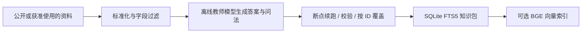
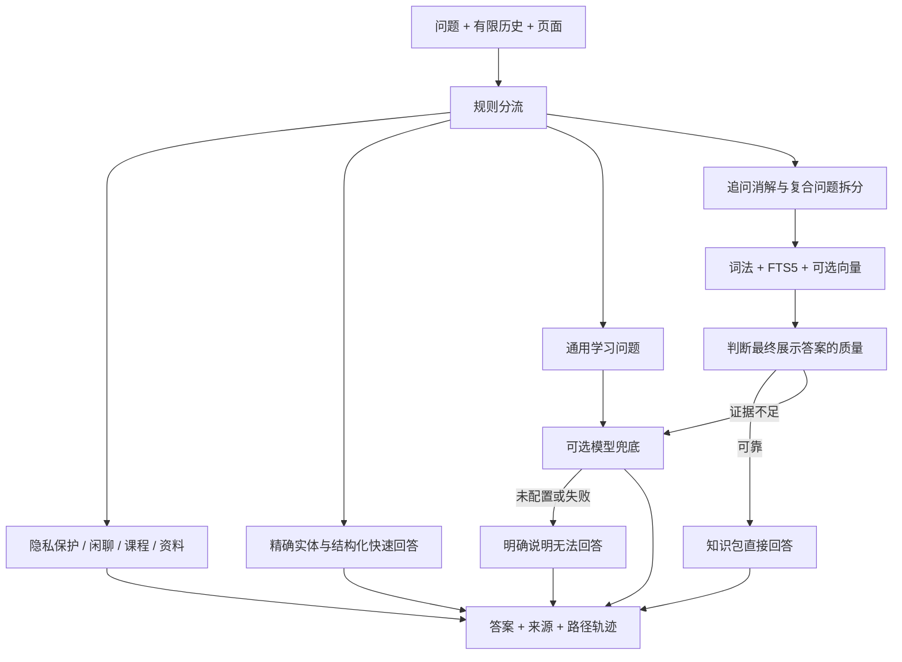

# LGU HUB AI Assistant Blueprint

**把站内 AI 小助手的实现拆成可运行、可观察、可复现的技术路径。**

本项目基于 LGU HUB 的实际代码整理：离线知识加工、SQLite 知识包、规则分流、词法/向量检索、证据质量判断、按需模型兜底。附中文交互页面，可展开每次请求的候选与判断过程。

**不含生产数据、个人信息、真实课程文件、API key、凭据或原仓库历史。** 10 条知识记录和 16 条验证问题均为人工编写的虚构数据。`example.invalid` 是无效示例域名。

## 3 分钟运行

需要 Python 3.10+ 和带 FTS5 trigram 的 SQLite 3.34+。基础演示仅使用 Python 标准库，无需安装依赖、下载模型或配置 key。

```bash
git clone https://github.com/Alert886/lguhub-ai-assistant-blueprint.git
cd lguhub-ai-assistant-blueprint
python -m assistant.pipeline
python -m assistant.server
```

打开 <http://127.0.0.1:8765>。Windows 中可将 `python` 替换为 `py`。

试试「介绍一下林知远教授」「图书馆在哪里；食堂在哪里」「告诉我他的成绩」「解释微积分」。分别观察精确命中、复合检索、隐私拦截与模型关闭时的明确拒答。页面的“在线回答 / 离线构建”地图可以点击切换并查看技术解释。

## 两条技术路径





这里的“蒸馏”指教师模型离线整理知识和问法，**不是训练或微调一个学生模型**。在线服务不必运行大型生成模型；本地检索能回答时不调用模型。

## 实现范围

| 能力 | 原站实现 | 此仓库 |
|---|---|---|
| 数据入口 | 多种公开来源及受控业务元数据 | 仅虚构 JSONL；不连接原站 |
| 蒸馏 | 本地 GPU 模型、模板回退、部分覆盖 | 模板基线 + 可选兼容接口蒸馏，追加式断点 |
| 知识包 | SQLite 结构化表、FTS、向量 | 同类结构，简化 schema，原子替换 |
| 检索 | 领域规则、FTS/词法候选、BGE、重排 | 可执行简化版；小样本全量词法排序，FTS 命中可查看 |
| 向量 | BGE-small-zh-v1.5，本地 ONNX | 从原站提取的 `vectors.py`，仅调整默认缓存根目录 |
| 质量判断 | 内容完整性、意图覆盖、展示候选相似度 | 简化词法阈值 + 展示候选相似度；不能照搬至生产 |
| 来源融合 | 复合问题 RRF | 子问分别回答，展示 RRF 来源诊断分数 |
| 模型 | 内置服务与用户自带配置 | 服务端环境变量配置单一接口；默认关闭 |
| 会话与缓存 | 有限历史、受条件约束的回答缓存 | 最近四条消息；无跨用户回答缓存 |
| 账户 / 积分 | 登录、权限、积分预留 | 不接入，避免复制业务系统与数据 |

这是一份技术展示重构，**不是生产系统的完整替代品，也不声称与原站逐字输出一致**。完整实现对应关系见 [技术架构与原站映射](docs/ARCHITECTURE.md)。

## 验证

```bash
python -m unittest discover -s tests -v
python -m scripts.evaluate
python -m scripts.audit_publication
```

结果写入本地 `build/evaluation.json`，不会提交构建数据库。验证记录见 [VALIDATION](docs/VALIDATION.md)。固定合成回归用例不能代表真实校园问答准确率、召回率或生产延迟。

## 深入使用

- [完整技术路径、关键参数与原站代码映射](docs/ARCHITECTURE.md)
- [离线构建、真实向量和模型接口的复现步骤](docs/REPRODUCE.md)
- [数据边界、密钥处理与发布检查](docs/DATA_BOUNDARY.md)
- [本次验证及尚未验证的部分](docs/VALIDATION.md)

目录：`assistant/` 是运行代码；`web/` 是路径展示；`data/` 是合成资料；`tests/` 是回归测试；`scripts/` 是评估与发布检查；`.github/workflows/` 是 CI。

本仓库未附加开源许可授权；公开用于技术展示，复用授权请与仓库所有者确认。可选模型及依赖遵循各自许可。
